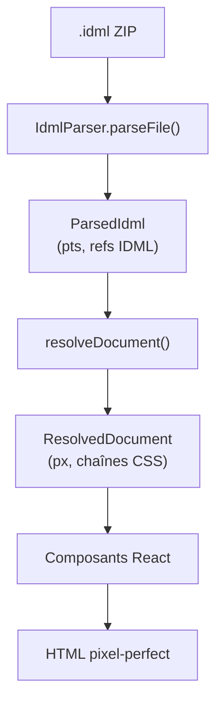

# idml2json

Un pipeline qui analyse les fichiers **Adobe InDesign IDML** et les restitue sous forme de composants React pixel-perfect utilisant le positionnement absolu et les transformations CSS.

```
.idml (ZIP)  →  ParsedIdml (pts)  →  ResolvedDocument (px / CSS)  →  React HTML
```

---

## Table des matières

1. [Concepts clés](#concepts-clés)
2. [Architecture](#architecture)
3. [Utilisation](#utilisation)
4. [Le pipeline en trois phases](#le-pipeline-en-trois-phases)
5. [Système de coordonnées](#système-de-coordonnées)
6. [Cascade de styles](#cascade-de-styles)
7. [Images](#images)
8. [Mise à l'échelle du viewport](#mise-à-léchelle-du-viewport)
9. [Patterns inhabituels & non évidents](#patterns-inhabituels--non-évidents)
10. [Tests](#tests)
11. [Débogage & observabilité](#débogage--observabilité)
12. [Limites connues](#limites-connues)
13. [Pourquoi pas X ?](#pourquoi-pas-x-)
14. [Pistes d'amélioration](#pistes-damélioration)
15. [Glossaire](#glossaire)

---

## Concepts clés

### IDML est une archive ZIP de fichiers XML

Un fichier `.idml` est une archive ZIP. Son contenu :

| Entrée | Contenu |
|--------|---------|
| `designmap.xml` | Index : liste tous les fichiers de spread et de story |
| `Resources/Graphic.xml` | Nuanciers de couleurs et dégradés |
| `Resources/Styles.xml` | Styles de paragraphe, de caractère et d'objet nommés |
| `Resources/Preferences.xml` | Dimensions des pages |
| `Spreads/Spread_*.xml` | Géométrie des pages, positions des frames et transformations |
| `Stories/Story_*.xml` | Contenu textuel (paragraphes, plages de caractères) |

### Points vs Pixels

InDesign travaille en **points typographiques** (1 pt = 1/72 pouce). CSS travaille en **pixels** (1 px = 1/96 pouce). La conversion appliquée dans le resolver est :

```
px = pt × (96 / 72)   ≈  pt × 1.3333
```

Toute sortie du parser est en **points**. Toute sortie du resolver est en **pixels**. Ne jamais les mélanger de part et d'autre de la frontière de phase.

### Les spreads contiennent les pages — les frames appartiennent aux spreads

Dans IDML, les frames (`<TextFrame>`, `<Rectangle>`, `<Polygon>`) sont positionnées dans l'espace de coordonnées de leur **spread**, et non de leur page. Un spread peut contenir plusieurs pages (ex. un spread gauche-droite dans un magazine).

Le resolver doit :
1. Calculer la position de chaque page dans l'espace du spread
2. Assigner chaque frame à la page dont la bounding box contient le centre de la frame
3. Soustraire l'origine de la page pour que les composants reçoivent des coordonnées relatives à la page

### Les transformations affines sont omniprésentes

Chaque frame possède un `ItemTransform = [a, b, c, d, tx, ty]`. Il s'agit d'une matrice affine 2D standard :

```
x' = a·x + c·y + tx
y' = b·x + d·y + ty
```

Pour calculer la bounding box d'une frame après transformation, le resolver transforme les **quatre coins** et calcule l'AABB (Axis-Aligned Bounding Box). Cela gère correctement les rotations et les cisaillements — soustraire les coins opposés ne suffit pas.

### Les styles forment une cascade à 4 couches

InDesign applique les styles de texte en couches. Chaque couche peut surcharger les propriétés définies par la couche inférieure :

```
1. Style de paragraphe nommé      ← priorité la plus basse
2. Surcharges inline de paragraphe
3. Style de caractère nommé
4. Surcharges inline de caractère ← priorité la plus haute
```

Les styles nommés forment également une chaîne d'héritage via `basedOn` avant d'entrer dans la cascade.

---

## Architecture

```
src/
├── config/
│   └── xml-parser.config.ts   Instance singleton de fast-xml-parser (partagée par tous les parsers)
│
├── helpers/
│   └── parser.helper.ts       toArray(), str(), num() — utilisés par tous les parsers
│
├── parser/
│   ├── idml.parser.ts         Orchestrateur ZIP — point d'entrée public pour le parsing
│   ├── designmap.parser.ts    Lit la liste des fichiers spread/story
│   ├── resources.parser.ts    Couleurs, dégradés, styles, dimensions de page
│   ├── spread.parser.ts       Pages, frames, géométrie, images, polygones, groupes
│   └── story.parser.ts        Contenu textuel : paragraphes, plages de caractères, surcharges
│
├── resolver/
│   ├── document.resolver.ts   Orchestrateur — ParsedIdml → ResolvedDocument (seul point d'entrée public)
│   ├── geometry.resolver.ts   Mathématiques affines : applyTransform, resolvePageGeometry, findPageForFrame
│   └── styles.resolver.ts     buildColorMap, buildStyleResolver, applyGradientAngle
│
├── types/
│   ├── idml.types.ts          Types post-parsing (pts, références ID IDML)
│   └── resolved.types.ts      Types post-resolve (px, chaînes CSS, sans ID IDML)
│
├── components/
│   ├── IdmlDocument.tsx        Racine : itère sur les pages, calcule l'échelle
│   ├── IdmlPage.tsx            Page unique : ordonne les frames en Z (graphique → polygone → texte)
│   ├── IdmlTextFrame.tsx       Div absolue, colonnes CSS optionnelles, overflow:hidden
│   ├── IdmlParagraph.tsx       <p> avec CSS de paragraphe
│   ├── IdmlTextRun.tsx         <span> + <br/> optionnel, gère scaleX/Y et lang
│   ├── IdmlGraphicFrame.tsx    Div absolue +  optionnel avec support flip/blend
│   └── IdmlPolygonFrame.tsx    Div absolue + chemin de Bézier cubique SVG
│
├── hooks/
│   └── useViewportWidth.ts    ResizeObserver → largeur courante du viewport
│
├── scripts/
│   └── convert-tiff.ts        Convertit automatiquement les fichiers TIFF en JPG via sharp
│
└── index.ts                   Point d'entrée CLI
```

### Flux de données



---

## Utilisation

### Prérequis

```
Node.js ≥ 18
pnpm
```

### Installation

```bash
pnpm install
```

### Parser un fichier IDML (CLI)

```bash
pnpm start path/to/file.idml
```

Cela génère deux fichiers à côté du `.idml` :

| Fichier | Contenu |
|---------|---------|
| `file.parsed.json` | Sortie brute du parser — modèle de domaine IDML, valeurs en points |
| `file.resolved.json` | Document prêt pour le rendu — valeurs en px, chaînes CSS, styles fusionnés |

Le CLI convertit également automatiquement les fichiers `.tiff`/`.tif` dans `public/images/` en `.jpg` avant le parsing.

### Lancer le renderer React

```bash
pnpm ui
```

Ouvre le serveur de développement Vite sur `http://localhost:3000`. Chargez un `resolved.json` depuis l'interface pour prévisualiser le document.

### Développement (mode watch)

```bash
pnpm dev   # tsx watch — relance le CLI à chaque modification dans src/
```

### Build

```bash
pnpm build   # tsc → dist/
```

### Tests

```bash
pnpm test         # vitest run (passe unique)
pnpm test:watch   # vitest en mode watch
```

---

## Le pipeline en trois phases

### Phase 1 — Parse

**Entrée :** `IdmlParser.parseFile(path)` dans `src/parser/idml.parser.ts`

Extrait le ZIP, lit chaque entrée XML, la mappe vers des types TypeScript. La sortie est `ParsedIdml` — tout est en points, les couleurs sont des auto-références IDML comme `"Color/Black"`, et les liens de style sont des ID IDML non résolus.

Comportements clés du parsing :
- **`toArray(v)`** normalise les éléments uniques vs les tableaux — fast-xml-parser retourne un objet quand il n'y a qu'un enfant et un tableau quand il y en a plusieurs. Toujours envelopper avec `toArray()`.
- **Attributs booléens** (`Underline`, `StrikeThru`, `Nonprinting`) sont des chaînes `'true'`/`'false'`. Le code les convertit en `boolean | undefined`. Ne jamais utiliser `Boolean(v)` — la chaîne `'false'` est truthy.
- **Préfixe `@_`** — tous les attributs XML sont préfixés par `@_` par la config du parser (`Self="x"` → `'@_Self': 'x'`).
- **Deux-points de namespace → underscores** — `<idPkg:Spread>` devient `idPkg_Spread` dans l'objet parsé.
- **Les éléments enfants `Properties` surchargent les attributs de même nom** dans le parsing des stories. Un nœud `<Properties><Leading>18</Leading></Properties>` l'emporte sur `@_Leading="10"`. Cela correspond au modèle de spécificité d'InDesign.

### Phase 2 — Resolve

**Entrée :** `resolveDocument(parsed)` dans `src/resolver/document.resolver.ts`

Transforme `ParsedIdml` en `ResolvedDocument`. C'est la phase la plus complexe :

- Convertit toutes les coordonnées de points en px
- Assigne les frames aux pages par intersection du point central
- Aplatit les chaînes de style `basedOn` (avec détection de cycles)
- Construit une `Map<string, string>` des ID de couleur IDML → chaînes CSS
- Applique la cascade de style à 4 couches par plage de texte
- Résout les styles d'objet (remplissage, contour, rayon de coin, transparence)
- Convertit les références d'images TIFF en `.jpg`

Le resolver est le seul endroit où les ID IDML sont échangés contre des valeurs résolues. Après cette phase, aucun composant ne devrait jamais voir une chaîne d'ID IDML.

### Phase 3 — Rendu

**Entrée :** `<IdmlDocument document={resolved} targetWidth={w} />`

React pur. Chaque composant reçoit des données déjà résolues et les applique en CSS inline. Aucune logique, aucune connaissance d'IDML. Ordre Z par page : **frames graphiques → frames polygonales → frames texte** (le texte est toujours au dessus).

---

## Système de coordonnées

### Espace spread vs espace page

```
Spread (une ou plusieurs pages côte à côte)
┌─────────────────────────────────────┐
│  Page 1            │  Page 2        │
│  spreadX=0         │  spreadX=595px │
│  spreadY=0         │  spreadY=0     │
│                    │                │
│  [TextFrame]  ←─── position dans l'espace du spread
└─────────────────────────────────────┘
```

Le resolver soustrait l'origine de la page pour donner aux composants des coordonnées relatives à la page. Une frame en position spread (650px, 100px) sur la Page 2 (origine 595px) devient (55px, 100px) relative à la Page 2.

### Assignation frame-à-page

`findPageForFrame()` calcule l'AABB de la frame dans l'espace du spread, prend son **point central**, et retourne la première page dont la bounding box le contient. Repli sur `pages[0]` si aucune page ne correspond.

> **Piège :** Une frame à cheval sur deux pages est assignée à la page contenant son centre — le contenu proche du fond peut être assigné à la mauvaise page.

### Ordre des GeometricBounds

`GeometricBounds = [top, left, bottom, right]` — c'est la convention IDML, **pas** l'ordre du modèle de boîte CSS `[top, right, bottom, left]`. Facile à confondre lors de la lecture ou de l'écriture directe des bounds.

---

## Cascade de styles

Le resolver construit un `StyleResolver` une fois par document et appelle `resolveRange(para, range)` pour chaque plage de texte dans chaque story.

### Héritage basedOn

Les styles nommés forment un arbre via les références `basedOn`. Avant d'entrer dans la cascade, chaque style nommé est **aplati** : les propriétés sont fusionnées depuis l'ancêtre racine jusqu'au style nommé. Le résultat est mis en cache.

- `$ID/[No paragraph style]` et les références similaires préfixées par `$ID/` sont la sentinelle racine d'InDesign — traitées comme n'ayant pas de parent.
- La détection de cycle utilise un `visited: Set<string>` — les chaînes `basedOn` circulaires sont interrompues à la première référence répétée.

### Conversion CMYK → RGB

InDesign stocke les valeurs CMYK sur une échelle de 0 à 100. L'approximation utilisée :

```
r = round(255 × (1 - c/100) × (1 - k/100))
g = round(255 × (1 - m/100) × (1 - k/100))
b = round(255 × (1 - y/100) × (1 - k/100))
```

Il s'agit d'une approximation algébrique simple. Elle ne tient pas compte des profils ICC — le résultat peut différer visiblement du rendu soft-proof d'InDesign, surtout pour les couleurs CMYK saturées.

### Conversion de l'angle de dégradé

L'angle 0° d'InDesign signifie gauche→droite ; CSS `90deg` signifie également gauche→droite. La conversion :

```
cssAngle = ((90 - idmlAngle) % 360 + 360) % 360
```

Exemples : InDesign 0° → CSS 90deg, InDesign 90° → CSS 0deg, InDesign 180° → CSS 270deg.

### Tint

Une valeur de tint de `-1` signifie 100% d'opacité (pas d'effet de tint). Les valeurs de 0 à 99 sont approximées en CSS `rgba` avec le tint comme canal alpha sur fond blanc — pas un vrai tint d'encre.

---

## Images

### Trois cas de stockage

| Cas | `StoredState` | Où se trouve l'image | Ce que le resolver produit |
|-----|---------------|---------------------|---------------------------|
| **Base64 inline** | `Embedded` + CDATA dans le XML | Dans le XML de l'archive IDML | `data:image/jpeg;base64,...` |
| **Fichier embarqué dans le ZIP** | `Embedded` (sans CDATA) | Dans l'archive IDML en tant que fichier | `/images/filename.jpg` |
| **Fichier lié** | `Normal` | Sur le disque de l'auteur | `/images/filename.jpg` |

Pour les cas 2 et 3, placez les fichiers images dans `public/images/`. Vite sert ce répertoire de manière statique.

### Conversion automatique TIFF

Au démarrage du CLI, `src/scripts/convert-tiff.ts` scanne `public/images/`, convertit chaque `.tif`/`.tiff` en `.jpg` (qualité 90 via `sharp`), et supprime l'original. Déposez les TIFFs dans `public/images/` sans les pré-convertir — le script s'en charge.

> **Piège :** La conversion TIFF se produit au moment du parsing, pas au démarrage du renderer. Si vous lancez `pnpm ui` directement sans avoir exécuté `pnpm start` auparavant, les TIFFs ne seront pas convertis et les images seront absentes.

### Positionnement de l'image dans sa frame

Une image InDesign possède son propre `ItemTransform` qui la positionne et la met à l'échelle dans la frame graphique. Le resolver combine la transformation de la frame et celle de l'image pour calculer :

```
offsetX = tx × PT_TO_PX      (origine de l'image relative à l'origine de la frame)
offsetY = ty × PT_TO_PX
width   = naturalWidth  × scaleX × PT_TO_PX
height  = naturalHeight × scaleY × PT_TO_PX
```

Les valeurs d'échelle négatives produisent `flipX: true` / `flipY: true`, que le composant restitue en `transform: scaleX(-1)` / `scaleY(-1)`.

---

## Mise à l'échelle du viewport

Le renderer utilise `transform: scale()` plutôt que de convertir les coordonnées en pourcentages.

### Pourquoi pas les pourcentages ?

`font-size`, `letter-spacing`, `line-height`, `border-width` et `box-shadow` n'ont pas d'unité CSS qui s'adapte relativement à un conteneur parent. Avec `transform: scale()`, un seul scalaire transforme toute la page de manière uniforme — y compris toutes les métriques de texte.

### Modèle de mise à l'échelle à deux divs

`IdmlPage` utilise deux divs imbriquées pour que la page mise à l'échelle participe correctement au flux du document :

```
div extérieure :
  width  = pageWidth  × scale   ← réserve l'espace réel de mise en page
  height = pageHeight × scale

  div intérieure :
    width  = pageWidth            ← page à taille naturelle
    height = pageHeight
    transform: scale(scale)       ← mise à l'échelle visuelle
    transformOrigin: top left     ← ancrage en haut à gauche, pas au centre
```

Sans l'enveloppe extérieure, la page mise à l'échelle déborderait de l'espace qui lui est alloué et chevaucherait les éléments frères.

### Personnaliser la largeur cible

```tsx
// Remplir le viewport
<IdmlDocument document={doc} targetWidth={viewportWidth} />

// Maximum 1200px, centré
<IdmlDocument document={doc} targetWidth={Math.min(viewportWidth, 1200)} />

// Zoom fixe : 50%
<IdmlDocument document={doc} targetWidth={doc.pageWidth * 0.5} />
```

---

## Patterns inhabituels & non évidents

### `??` et non `||` pour la fusion des styles d'objet

Les propriétés de style d'objet incluent `0`, `false` et les chaînes vides comme valeurs valides. Le resolver utilise `??` (nullish coalescing) pour fusionner les valeurs inline de la frame avec les valeurs par défaut du style d'objet :

```ts
const fillTint = frame.fillTint ?? objStyle?.fillTint;
```

Utiliser `||` éliminerait silencieusement `0` (tint transparent) et `false` (propriété désactivée). C'est un vecteur de bug subtil et récurrent lors de l'ajout de nouvelles propriétés.

### `softReturn` est `true | undefined`, jamais `false`

Le retour souple d'InDesign (Shift+Entrée) est représenté par un élément `<Br/>` à l'intérieur d'un `<CharacterStyleRange>`. Le champ parsé est `softReturn: true | undefined`. Il n'est jamais mis à `false` — l'absence signifie pas de retour souple. Le composant restitue `<br/>` après le span uniquement quand `softReturn === true`.

### Aplatissement des styles au moment du build, pas par plage

`buildStyleResolver()` aplatit toutes les chaînes `basedOn` **une fois** lors de l'appel, avant toute résolution de texte. La résolution par plage ne fait que fusionner les quatre couches de la cascade. Cela importe à grande échelle : un document avec 50 000 plages de texte et 200 styles calcule l'héritage de chaîne 200 fois, pas 50 000 fois.

### Les frames sont au niveau du spread ; les groupes propagent les transformations

Les éléments `<Group>` dans IDML imbriquent des frames et portent leur propre `ItemTransform`. Le spread parser visite récursivement les groupes et **combine** la transformation du groupe avec celle de chaque enfant par multiplication matricielle avant de stocker l'enfant. Au moment où une frame sort du parser, son `itemTransform` incorpore déjà toutes les transformations des groupes parents — le resolver n'a jamais besoin de savoir qu'une frame était dans un groupe.

### Les chemins de polygone sont dans l'espace local de l'item

Les ancres de points de chemin (attributs `Anchor="x y"`) sont dans l'**espace de coordonnées local de l'item** du polygone — avant que `ItemTransform` soit appliqué. Pour les convertir en px relatifs à la frame pour le rendu SVG :

```ts
const [sx, sy] = applyTransform(frame.itemTransform, localX, localY); // → spread pts
const svgX = pt(sx) - pageGeo.spreadX - frameGeo.x;
const svgY = pt(sy) - pageGeo.spreadY - frameGeo.y;
```

### `Leading` est `number | 'Auto'`

Le leading d'InDesign peut être une valeur en points spécifique ou la chaîne `'Auto'` (interlignage automatique, généralement 120% de la taille de la police). Le type `Leading = number | 'Auto'` reflète cela. Le resolver convertit le leading numérique en `line-height` en px ; `'Auto'` est omis, laissant le navigateur utiliser son interlignage par défaut — une approximation.

### Les couleurs LAB et Mixed tombent en repli sur le noir

Les couleurs dans les espaces colorimé LAB ou Mixed nécessitent un profil ICC pour calculer des équivalents RGB précis. Le resolver produit `#000000` pour celles-ci. En pratique, les documents InDesign utilisent souvent LAB pour les repères de repérage ou des couleurs de marque spécifiques — celles-ci apparaîtront noires dans le renderer.

---

## Tests

### Lancer les tests

```bash
pnpm test          # exécution unique
pnpm test:watch    # mode watch
```

### Structure des tests

```
src/
├── helpers/__tests__/
│   └── parser.helper.test.ts       Cas limites de toArray, str, num
├── parser/__tests__/
│   ├── designmap.parser.test.ts    Parsing de la liste des sources spread/story
│   ├── resources.parser.test.ts    Couleurs, dégradés, tous les types de styles
│   └── story.parser.test.ts        parseLeading, paragraphes, surcharges, softReturn
└── resolver/__tests__/
    ├── basedOn.test.ts             Héritage de chaîne basedOn pour tous les types de styles
    ├── pipeline.test.ts            Cascade complète à 4 couches, toutes props, tint, visibilité
    ├── geometry.resolver.test.ts   Calculs applyTransform, géométrie page/frame, assignation de page
    └── colorMap.test.ts            Formule CMYK→RGB, dégradés, applyGradientAngle
```

### Philosophie

Les tests sont des **tests unitaires contre de la logique réelle** — pas de mock du parser XML ni du système de fichiers. Les tests du parser construisent des chaînes XML minimales qui passent par l'instance réelle de `fast-xml-parser`, les rendant sensibles aux changements de configuration du parser. Les tests du resolver utilisent des fonctions factory pour construire directement des objets `ParsedIdml`, en contournant entièrement le parser.

Il n'y a pas de tests de composants aujourd'hui — la couche de rendu est visuelle et se vérifie mieux en lançant le serveur de développement Vite. Le snapshot de référence `assets/file.resolved.json` sert de référence pour la régression visuelle.

### Alias de chemin dans les tests

Tous les alias de chemin de `tsconfig.json` (`@helpers/*`, `@config/*`, `@resolver/*`, etc.) sont reproduits dans `vite.config.ts` pour que Vitest les résolve correctement. Lorsque vous ajoutez un nouvel alias à `tsconfig.json`, ajoutez-le également à `vite.config.ts`.

---

## Débogage & observabilité

### Fichiers JSON intermédiaires

`pnpm start file.idml` écrit deux fichiers JSON :

- **`file.parsed.json`** — inspectez ce que le parser a extrait. Si une frame est manquante ou a de mauvaises bounds, commencez ici.
- **`file.resolved.json`** — inspectez ce que le resolver a produit. Si une frame a des données parsées correctes mais un rendu incorrect, le bug est dans le resolver.

### Sortie CLI

```
Parsing /path/to/file.idml...
Raw parsed  → file.parsed.json
  2 spread(s), 4 story/stories
  18 paragraph styles, 12 character styles
  27 colors

Resolving...
Resolved    → file.resolved.json
```

Le nombre de styles et de spreads affiché par le CLI est le premier contrôle de sanité — si un document a 0 styles de paragraphe, la structure XML ne correspond probablement pas à ce qu'attend le parser.

### Attributs `data-self`

Chaque composant de frame restitué définit `data-self={frame.self}` sur son élément racine. Dans les DevTools du navigateur, vous pouvez inspecter n'importe quelle frame, lire son ID self InDesign, puis rechercher cet ID dans `file.parsed.json` pour le retracer à travers le pipeline.

### Modes d'échec courants

| Symptôme | Cause probable |
|----------|---------------|
| Frame entièrement absente | `Visible=false`, ou frame dans un `<Group>` non parcouru, ou `findPageForFrame` l'a assignée à la mauvaise page |
| Frame à la mauvaise position | Mauvaise soustraction de l'origine de la page ; vérifier `spreadX`/`spreadY` dans `file.resolved.json` |
| Texte invisible | `fillColor` résolu à `undefined` ; vérifier que la référence de couleur dans `parsed.json` existe dans `colors[]` |
| Image absente | Fichier non placé dans `public/images/` ; TIFF non converti (lancer `pnpm start` avant `pnpm ui`) |
| Mauvais style de texte | Vérifier l'ordre de la cascade — une surcharge inline de caractère peut l'emporter sur un style nommé |
| Remplissage noir sur un dégradé | Référence de couleur de stop absente de `colors[]` — repli sur `#000000` |

---

## Limites connues

| Domaine | Limitation |
|---------|-----------|
| **Couleurs LAB / Mixed** | Repli sur le noir — un profil ICC serait nécessaire |
| **SmallCaps** | Approximé en `text-transform: capitalize` — pas de vraies petites capitales |
| **Interlignage automatique** | Rendu sans `line-height` — la valeur par défaut du navigateur est une approximation |
| **Rotation des frames** | Les transformations sont utilisées pour calculer l'AABB de positionnement ; la rotation CSS de la frame elle-même n'est pas appliquée — les frames pivotées apparaissent non pivotées à la position correcte de leur bounding box |
| **Frames chevauchant deux pages** | Assignées à la page contenant le centre de la frame |
| **Tables** | Non parsées |
| **Objets ancrés** | Non parsés |
| **Notes de bas de page** | Non parsées |
| **Surcharges de page maître** | Non parsées |
| **Texte sur un tracé** | Non parsé |
| **Filets de paragraphe** | Non parsés |
| **CDATA dans `<Content>`** | Non extrait par la configuration actuelle du parser — le texte arrive via `#text` uniquement |
| **Images inline dans le texte** | Non supportées |

---

## Pourquoi pas X ?

### Pourquoi pas un navigateur headless ou un renderer PDF ?

Headless Chrome / Puppeteer produirait un rendu fidèle, mais la sortie est une image plate ou un PDF — pas du HTML interactif. Ce projet produit un DOM vivant qui peut être recherché, sélectionné, copié et stylisé davantage (ex. pour des annotations ou des superpositions de formulaires sur un contrat scanné).

### Pourquoi pas CSS grid / flexbox pour la mise en page ?

Les frames InDesign sont positionnées de manière absolue, potentiellement superposées, pivotées ou couvrant des colonnes partielles. Il n'y a pas de hiérarchie de mise en page sémantique — uniquement des coordonnées. Le positionnement absolu est le seul modèle qui s'associe 1:1 sans algorithme de mise en page avec perte.

### Pourquoi pas les unités `vw` / `%` pour la mise à l'échelle ?

Voir [Mise à l'échelle du viewport](#mise-à-léchelle-du-viewport). En résumé : les métriques de texte (`font-size`, `letter-spacing`, `line-height`) n'ont pas d'équivalent `%`-du-parent. `transform: scale()` est la seule primitive CSS qui met à l'échelle toutes les propriétés uniformément.

### Pourquoi pas un renderer canvas ?

La sortie canvas n'est pas interactive (pas de sélection de texte, pas d'accessibilité). La sortie basée sur le DOM reste consultable par la recherche du navigateur, les lecteurs d'écran et le copier-coller. Pour un visualiseur de documents, le DOM est strictement meilleur.

### Pourquoi fast-xml-parser plutôt qu'un parser DOM ?

`fast-xml-parser` est significativement plus rapide que DOMParser ou `xml2js` pour les grands fichiers InDesign (certains spreads IDML font plusieurs Mo de XML). Il tourne également dans Node.js sans polyfill DOM. Le compromis est sa forme de sortie non standard (le préfixe `@_`, la liste blanche `isArray`) qui nécessite un enveloppement soigneux.

---

## Pistes d'amélioration

- **Rotation des frames** — appliquer `transform: rotate()` en utilisant l'angle de la matrice affine extrait via `Math.atan2(b, a)`. La géométrie est déjà résolue correctement ; seul le CSS manque.
- **Support des tables** — les éléments `<Table>` existent dans IDML avec une structure de cellule bien définie ; le mapping vers un CSS grid ou un `<table>` HTML est faisable.
- **Objets ancrés** — les frames inline (`<AnchoredObject>`) pourraient être restituées en éléments `position: relative` dans le flux de texte.
- **Vraies petites capitales** — `font-variant-caps: small-caps` pour les polices qui le supportent ; repli sur une transformation d'échelle synthétique.
- **Rendu côté serveur** — le resolver produit un objet JSON simple ; `ReactDOMServer.renderToString()` pourrait pré-rendre les pages pour un hébergement statique sans JavaScript client.
- **Diff / suivi des modifications** — comparer deux objets `ResolvedDocument` pourrait mettre en évidence les modifications de texte ou de mise en page entre les versions d'un document.
- **Support des couleurs LAB** — calculer le RGB précis depuis LAB nécessite un profil ICC ; `color.js` le fournit mais alourdit le bundle.

---

## Glossaire

| Terme | Signification |
|-------|--------------|
| **Spread** | Un canvas IDML qui contient une ou plusieurs pages côte à côte (ex. un spread deux pages dans un magazine). Les frames sont positionnées dans l'espace du spread. |
| **Story** | Un conteneur de texte IDML. Une story peut s'étendre sur plusieurs frames texte (frames liées). |
| **ItemTransform** | Une matrice affine à 6 nombres `[a, b, c, d, tx, ty]` attachée à chaque frame. Encode la position, la rotation, l'échelle et le cisaillement dans l'espace de coordonnées parent. |
| **GeometricBounds** | Un tuple à 4 nombres `[top, left, bottom, right]` dans l'espace local de l'item, en points. Notez l'ordre top-first — c'est la convention IDML, pas CSS. |
| **basedOn** | Une référence d'héritage de style. Un style de paragraphe avec `basedOn="Body"` hérite de toutes les propriétés de "Body" et ne surcharge que ce qu'il définit explicitement. |
| **ParsedIdml** | Le type TypeScript produit par le parser. Valeurs en points, couleurs sous forme de chaînes self-ID IDML (ex. `"Color/Black"`). |
| **ResolvedDocument** | Le type TypeScript produit par le resolver. Valeurs en px, couleurs sous forme de chaînes CSS. Peut être passé directement aux composants React. |
| **Self** | Une chaîne d'ID interne InDesign (ex. `"TextFrame/u3f2"`). Utilisée comme clés dans les maps et comme attributs de débogage `data-self` sur les nœuds DOM. |
| **Soft return** | Un saut de ligne inséré avec Shift+Entrée dans InDesign. Représenté par `<Br/>` dans le XML et `softReturn: true` dans le type parsé. Restitué en `<br/>` après le span. |
| **Tint** | Un pourcentage (0–100) appliqué à une couleur de remplissage ou de contour. `-1` signifie 100% (pas de tint). Approximé en opacité CSS `rgba` sur fond blanc. |
| **Object style** | Un style nommé qui stocke les propriétés au niveau de la frame : couleur de remplissage, contour, rayon de coin, transparence. Analogue aux styles de caractère/paragraphe mais pour les frames plutôt que le texte. |
| **PT_TO_PX** | La constante `96 / 72 ≈ 1.3333`. Multiplier toute valeur en points par celle-ci pour obtenir des pixels. Définie localement dans chaque fichier qui en a besoin — pas un import partagé. |
